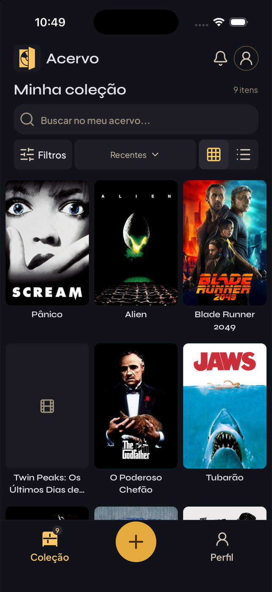
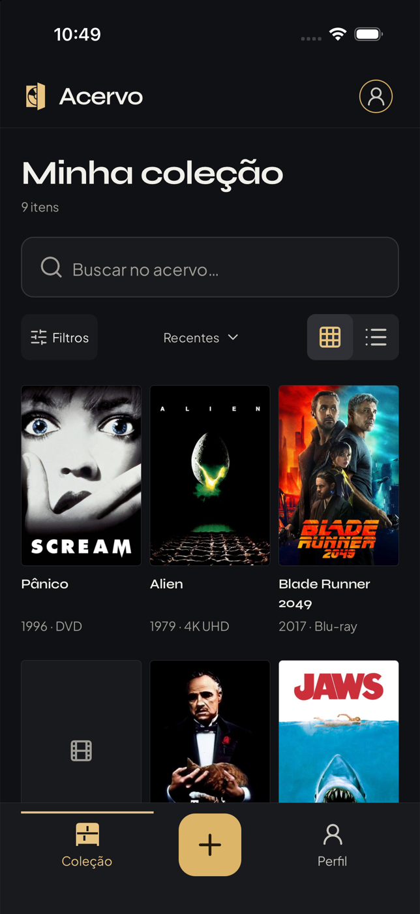
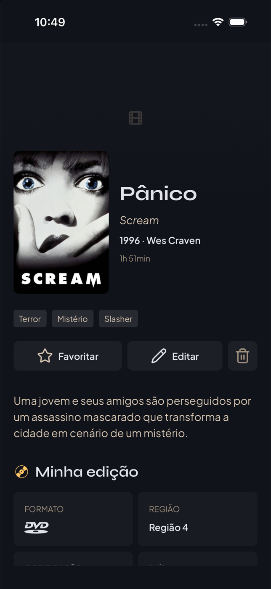
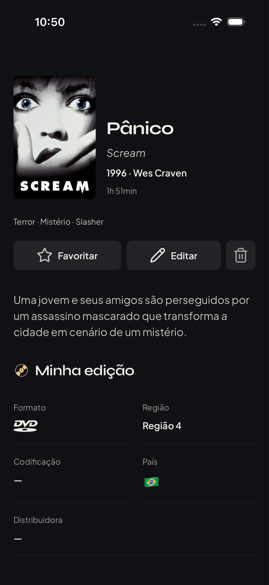
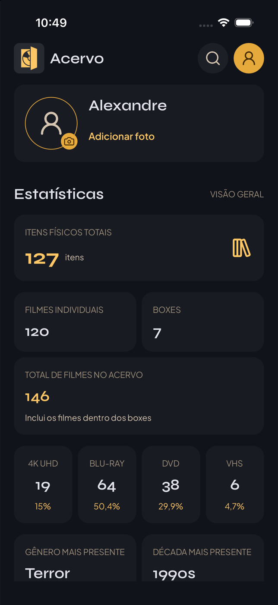
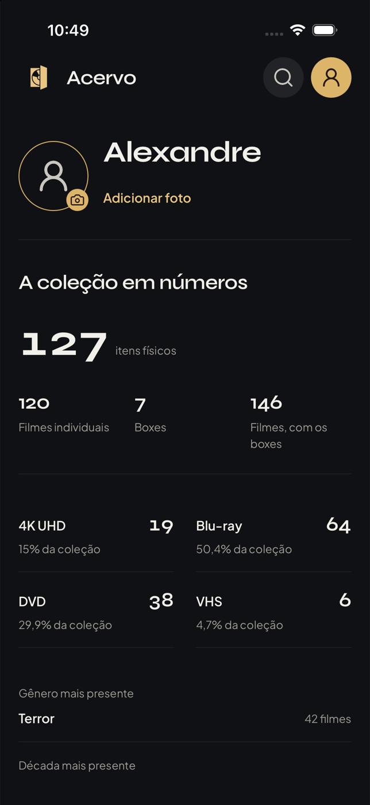
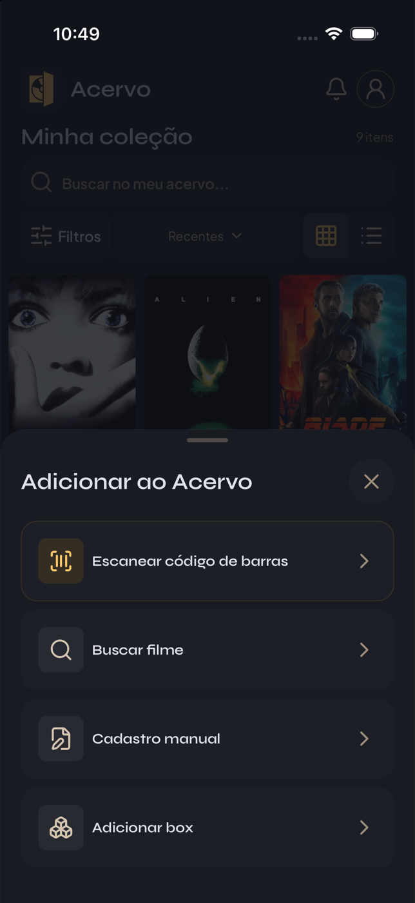
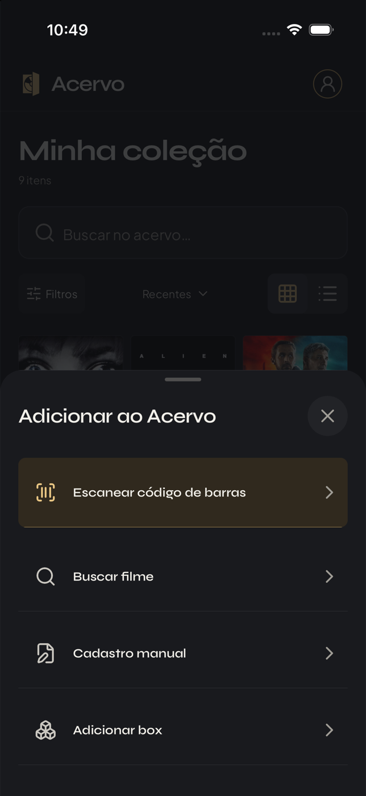

# Refinamento visual — branch experimental

Implementado em `experiment/ai-design-skills`, sobre o commit `9b4dacd`.

## Direção

O Acervo continua sendo uma estante de mídias físicas: grafite, dourado, Syne e
Plus Jakarta Sans. As capas têm prioridade. O dourado distingue ações e seleção;
a hierarquia vem de tipografia, alinhamento e espaço, em vez de mais caixas.

- **Coleção:** marca compacta, avatar como acesso ao perfil, título com mais
  presença, contador separado e busca com estado de foco. Margens da estante e
  cabeçalho alinhadas. Capas mantêm suas proporções; títulos ficam à esquerda,
  com duas linhas reservadas conforme a escala da fonte e ano/formato abaixo.
- **Lista:** linhas com divisores, títulos maiores e ano/formato visíveis.
- **Navegação:** destinos simétricos, indicação da aba ativa e ação de adicionar
  em dourado. O contador permanece no cabeçalho e no rótulo acessível da coleção.
- **Detalhes:** mais espaço para o título, gêneros em uma linha que pode quebrar
  naturalmente e ficha da edição com divisores. Código de barras, distribuidora
  e nome da edição usam a largura disponível.
- **Perfil:** identidade sem card externo, total em destaque, formatos em duas
  colunas e metadados em linhas. Atalhos separados por divisores.
- **Adicionar e filtros:** menos caixas repetidas; scanner e seleção recebem
  destaque. Chips, botões e campos compartilham a mesma linguagem de superfícies.
- **Interação:** resposta curta de pressão com `Animated`, foco visível e
  observação da preferência nativa de reduzir movimento, inclusive suas mudanças
  durante o uso. Não há animações contínuas novas.

`gpt-taste` orientou a hierarquia editorial, a contenção de cards e o feedback.
Suas receitas de landing pages, GSAP, fontes alternativas e espaçamentos de web
foram adaptadas ao escopo mobile e à identidade solicitada. A revisão de
`web-design-guidelines` usou a [fonte das regras](https://raw.githubusercontent.com/vercel-labs/web-interface-guidelines/main/command.md),
traduzindo foco, rótulos, contraste, áreas de toque e movimento para React Native.

Nenhuma dependência foi adicionada. Consultas, persistência, autenticação,
modelos e handlers dos fluxos de cadastro/edição/exclusão permanecem existentes.

## Comparação visual

Capturas no simulador **iPhone 17 Pro / iOS 26.5**, com os componentes nativos.
Foi usado um harness temporário com os mesmos dados fictícios nas duas versões,
sem autenticar, ler ou alterar a coleção do usuário. O harness foi removido
após a captura. As imagens demonstram a apresentação dos componentes e não
constituem um teste completo dos fluxos autenticados. Uma capa de demonstração
indisponível exercita o placeholder nativo nas duas versões.

| Tela | Antes (`9b4dacd`) | Depois |
| --- | --- | --- |
| Coleção |  |  |
| Detalhes |  |  |
| Perfil |  |  |
| Adicionar |  |  |

## Visualizar o aplicativo

Na branch experimental, execute `npm start` e abra no dispositivo compatível.
Para o simulador iOS: `npm run ios`. Entre normalmente para conferir a coleção
real, alternar grid/lista, abrir os filtros, visitar um item, abrir o painel de
adicionar e consultar o perfil.

Para executar a versão anterior sem desfazer estas alterações, use outro diretório:

```sh
git worktree add /tmp/acervo-before 9b4dacd
cd /tmp/acervo-before
npm ci
# Configure localmente as mesmas variáveis de .env.example.
npx expo start --port 8082
```

Abra cada versão separadamente e use a mesma conta e o mesmo dispositivo. Evite
cadastrar ou remover itens durante uma comparação visual, pois as duas versões
usam o mesmo backend quando configuradas com o mesmo projeto.

## Verificações

- TypeScript em modo estrito.
- Suíte existente: 293 testes de domínio e serviços.
- Build nativo iOS no simulador.
- Exportação dos bundles Android e iOS.
- Revisão visual das quatro composições nas capturas.
- Contrastes medidos: texto principal/fundo 16,57:1; texto secundário/superfície
  10,19:1; texto discreto/superfície elevada 5,80:1; texto sobre dourado 8,80:1.

A validação visual realizada é de iOS. Ainda é necessário conferir em dispositivo
Android, com VoiceOver/TalkBack, teclado e fontes ampliadas. As capturas não
comprovam esses cenários nem o fluxo completo autenticado de gravação.
